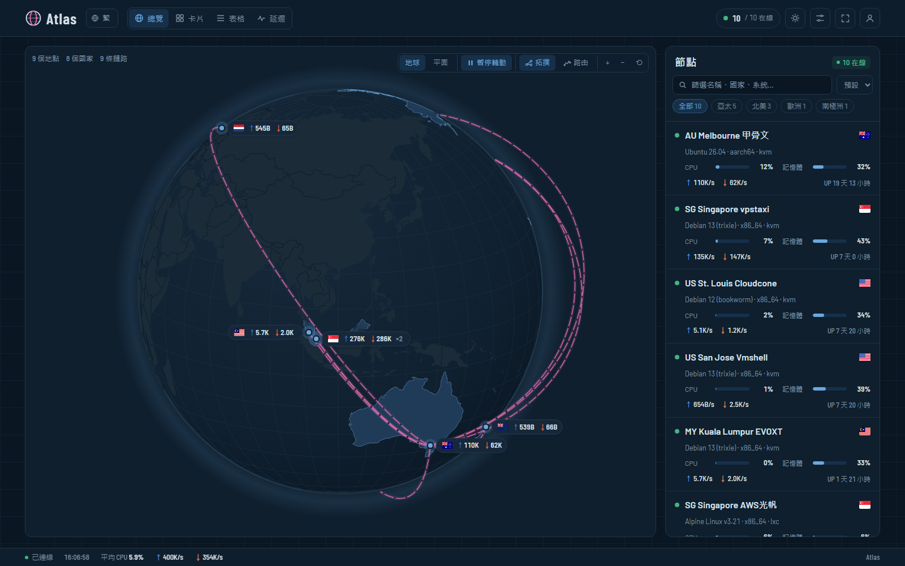

# Atlas

**English** · [繁體中文](README.zh-Hant.md) · [简体中文](README.zh-Hans.md)



A theme for the [monitor](https://monitor-document.pages.dev/) server probe: a globe / flat world map with the nodes lit on it, a node topology drawn as arches, node cards, a table, latency charts and detail pages. Light or dark; Traditional Chinese, Simplified Chinese or English.

The theme works on any hub as it is. Three extras are **optional** and need a little setup on your side, because they run on your servers rather than in the browser: [real routes](#real-routes-真實路由), a [submarine cable map](#submarine-cable-map-海纜底圖) and [streaming checks](#streaming-checks-流媒體檢測). Without them the theme simply doesn't show those parts.

## Install

In the hub: 主題 → install from a repository, using this repository's URL (the hub fetches `theme.tar.gz` from the latest release). Or download `theme.tar.gz` from Releases and upload it on the 主題 page.

### Komari (paused)

Komari support is paused and no longer released; the code below stays for reference. The same theme runs on [Komari](https://github.com/komari-monitor/komari) (1.6 or later): download `atlas-komari.zip` from Releases and upload it in Komari's admin → 主題設定. Settings appear on Komari's theme settings page. Live data comes from Komari's public API (`/api/nodes`, `/api/rpc2` `common:getNodesLatestStatus`, `/api/records/load` and `/api/records/ping`); Komari's ping tasks show as the latency probes, and the traffic column shows Komari's traffic counter. Topology and location lines take node names (or `#<uuid>`).

Your own data (routes, streaming snapshot) is keyed by the monitor hub's node ids; `node scripts/komari-ids.mjs` matches both hubs' nodes by name and writes `src/data/ids.json`, then `npm run pack:komari` builds `atlas-komari.zip` with it. `npm run dev:komari` proxies to `KOMARI_HUB` from `.env.local`. The live relay (`relay/`) is written for the monitor hub; on Komari the theme falls back to the bundled snapshots.

## Settings (panel → 主題 → Atlas → 設定)

- **節點位置**: one line per node, `name or #id = city` or `= lat,lng`. Nodes without a line are placed by a city keyword in their name (English, Chinese or IATA code, see `src/lib/geo.ts`), then by country.
  ```
  Tokyo Node A = Osaka
  #8 = -36.85,174.76
  ```
- **節點拓撲**: one chain per line, hops joined by `->`. A hop is a node name, `#id`, a city name or `lat,lng`; text after `|` is the label.
  ```
  Guangzhou -> HK Relay -> SG Node | 中轉
  #1 -> #4 | 落地
  ```
  Links are blue and animated while every node on them is online, red and dashed otherwise. With no custom topology, the 中心節點 (or the first node) is linked to every other node.
- Map mode, auto-rotation, lit countries, map labels, grey-out of cables no route rides, summary tiles, which latency probes the cards show, offline ordering, a notice line, and the switches for the optional extras.

- **Background image** (背景圖片網址, blur, dimming): with one set, panels turn to frosted glass. Visitors can use their own picture instead (a URL, or an upload that stays in their browser), tune it, or switch it off in ⚙.

Clicking a node in the cards, table or latency view opens its details in a dialog (resources, network and traffic, latency and loss, server info, with a time range); 「完整詳情」 opens the full page. Esc or Back closes it.

The map zooms with Ctrl/⌘ + wheel or the +/− buttons, so plain scrolling still scrolls the page.

## Optional extras

| Extra | What it shows | What you need |
|---|---|---|
| Real routes | each topology link along the path packets take, coloured by network (AS) | SSH to one node with `mtr`; Node.js locally; build your own package |
| Submarine cable map | sea crossings along cables, a cable base map | the TeleGeography 2022 snapshot (non-commercial licence) |
| Streaming checks | Netflix / Disney+ / ChatGPT … per node | a snapshot over SSH, or the live relay on the hub |

Real routes and snapshot streaming checks are baked into **your own build**: generate the data, then `npm run pack` and upload that `theme.tar.gz` to your hub. The data lands in `src/data/` and `scripts/data/`, which are git-ignored and never part of the public release.

### Real routes (真實路由)

The 「路由」 map button (and the 真實路由 switch in ⚙) redraws each topology link along the real path, coloured by network, with a legend and an AS-by-AS timeline in the node sidebar.

```bash
cp routes.local.example.json routes.local.json   # then fill in your nodes
node scripts/routes.mjs          # every link listed in routes.local.json
node scripts/routes.mjs 1>3      # just one link, merged into the existing data
node scripts/routes.mjs --replan # no tracing: redo only the sea crossings
npm run pack
```

`routes.local.json` (git-ignored) maps hub node IDs to an SSH alias, the address to trace and the node's coordinates; `"links": ["1>*"]` traces from node 1 to every other node. For each link the script SSHes into the source and runs `mtr --json`, then places routers by the city codes in their reverse DNS (`syd14`, `sjc01`, `tokyjp05`, Equinix `me1` …), falling back to ip-api.com, and discards any location the RTT makes physically impossible or that sends the path on a detour. Router addresses (never the nodes' own) go to ip-api.com for that lookup; unnamed AS numbers are looked up on RIPEstat. The written `src/data/routes.json` holds only AS numbers, cities, coordinates and RTTs, and both the script and `npm run pack` refuse to continue if a node address would end up in the bundle.

Without the cable data below, sea crossings are drawn as plain water paths over a 0.25° raster of Natural Earth land (public domain, via `world-atlas`).

**Live mode**: with the relay from [`relay/`](relay/README.md) installed, routes are traced by the relay instead (from the source node to every node, daily, and on a logged-in admin's 「追蹤路由」 / 「重新追蹤」), new nodes included as soon as their agent runs; no repacking.

Caveats: a traceroute shows one direction only (the return path can differ), routes change, and which cable carries a leg is an inference; re-run and repack to refresh.

### Submarine cable map (海纜底圖)

With it, sea crossings follow submarine cables and the full cable map is drawn underneath in TeleGeography's colours (name, ready-for-service year, length and owners on hover). The data is TeleGeography's Submarine Cable Map as TeleGeography published it on GitHub under **CC BY-NC-SA 3.0** (last snapshot 2022-08-05, 516 cables, 1,375 landing stations). The repository has since been taken down; the Internet Archive keeps the snapshot (`web.archive.org/web/2022*/github.com/telegeography/www.submarinecablemap.com`). It is **not included here**: the licence is non-commercial, so import it yourself only for a non-commercial status page.

```bash
node scripts/import-cables.mjs <path to …/web/public/api/v3>   # from the repository archive
node scripts/routes.mjs --replan
npm run pack
```

This writes `scripts/data/submarine-cables.json` (for matching) and `src/data/cables.json` (the base map, loaded only when routes are shown). Both stay under CC BY-NC-SA 3.0; the map credits TeleGeography in its corner whenever the cables are shown. See `scripts/data/README.md`.

A traceroute can't name the cable, so for each leg between two shores `scripts/lib/cables.mjs` finds the cheapest path through a graph of every in-service cable's drawing: by land to a landing in reach (same country and landmass, or under 300 km), along one or more cables (each extra system costs a little, stations within 60 km count as one), by land to the far waypoint; cables the carrier co-owns are a fifth cheaper. Cables still planned in the snapshot are drawn dashed but never matched. The lines are TeleGeography's stylised drawings, not surveyed routes, and the snapshot predates cables opened after mid-2022.

### Streaming checks (流媒體檢測)

Node details, the sidebar and the node cards show whether streaming and AI services work from each node: Netflix (full / originals only), Disney+, YouTube Premium, Prime Video, ChatGPT (full / web only), Claude, Gemini, Bilibili HK/MO/TW, Abema, Spotify and TikTok, each with the country the service places the node in (amber when it differs from the node's own country). Two ways to feed it:

- **Snapshot**, baked into your build:
  ```bash
  node scripts/media.mjs           # every node in routes.local.json with an ssh alias
  node scripts/media.mjs 2 7       # just these nodes, merged into the existing data
  node scripts/media.mjs --local   # run the probes on this machine, print only
  npm run pack
  ```
  The script pipes `scripts/lib/media-check.sh` into `sh -s` over SSH: plain IPv4 HTTPS requests with curl, nothing installed on the node. A node whose `mtr` runs as another user is checked as that user too. Only verdicts and country codes are written.
- **Live**, with the relay from [`relay/`](relay/README.md) next to the hub: results come from it, nodes re-check once a day on their own, and a logged-in admin gets 「點擊檢測」 / 「重新檢測」 buttons; a request is picked up within a minute. This works with the public release too, no rebuild needed: the theme looks for the relay at `/atlas-media/` and uses it when it answers.

Without either, the section isn't shown. Bahamut 動畫瘋 isn't included: it answers scripted requests with a 403 whatever the region. TikTok sometimes serves a challenge page to datacenter addresses, shown as 無法判斷.

## Language and appearance

The interface comes in Traditional Chinese, Simplified Chinese and English (the globe button in the top bar), and light or dark (the moon / sun button; the settings menu also offers "system"). The site's defaults are theme settings (預設語言, 預設外觀); a visitor's choice is kept in their browser. Strings live in `src/lib/i18n.ts`, written in Traditional Chinese in the code and looked up there for the other two.

## Development

```bash
npm ci
echo MONITOR_HUB=https://status.example.com > .env.local   # a hub with its public page on
npm run dev          # proxies /api, the WebSocket and /atlas-media to MONITOR_HUB
```

While developing, `theme.dev.json` (git-ignored, optional) stands in for the settings an owner would save in the panel; it is never part of the build.

```bash
npm run pack         # your build: type-check, build with your local data, write theme.tar.gz
npm run pack:base    # the public build: same, but leaves src/data out even if it exists
```

## Releasing

Bump `version` in `theme.json`, commit, and push a tag `v<version>`. The workflow in `.github/workflows/release.yml` builds the base theme from the clean checkout and publishes it as the release asset `theme.tar.gz`.

## Pages

`/` (overview: map, roster, summary), `/cards`, `/table`, `/latency` and `/node/{id}` (live gauges plus history charts). The hub serves `index.html` for all of them. Data comes from `/api/me`, `/api/nodes`, `/api/ws`, `/api/nodes/{id}/metrics` and `/api/themes/atlas/config`, plus `/favicon.svg` and, if present, `/atlas-media/results`. Allow these if a WAF or reverse proxy whitelists paths.

## Licence

The code is MIT (see `LICENSE`). The optional cable data keeps its own CC BY-NC-SA 3.0 licence and isn't in the repository.
