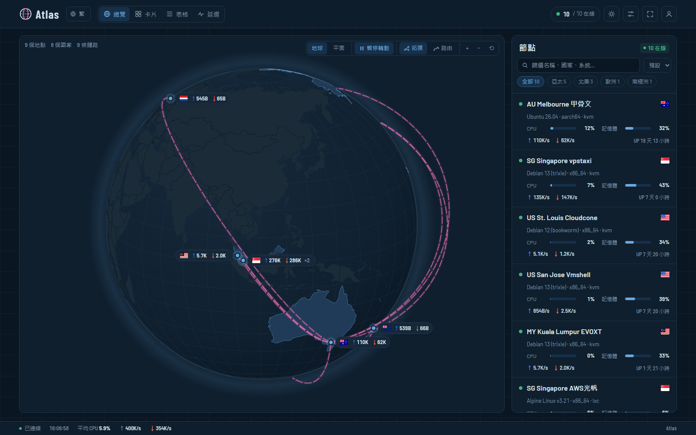

# Atlas

[English](README.md) · [繁體中文](README.zh-Hant.md) · **简体中文**

**演示站：[status.yddsfj.uk](https://status.yddsfj.uk)**（站上的横幅图片是站长自己的，不随主题提供）



[monitor 极简探针](https://monitor-document.pages.dev/) 的主题：海图风格的地球／平面地图，点亮有节点的国家，节点之间以拱形弧线画出拓扑；另有节点卡片、表格、延迟与详情页。支持浅色／深色，界面有繁體中文、简体中文与 English。

主题本身装上就能用。另外三项是**可选功能**，因为它们要在你的服务器上运行，需要自己配置：[真实路由](#真实路由)、[海缆底图](#海缆底图)、[流媒体检测](#流媒体检测)。没配置的话，主题就不显示那些部分。

## 安装

在后台「主题」页用本仓库地址安装（hub 会抓取最新 Release 里的 `theme.tar.gz`），或从 Releases 下载 `theme.tar.gz` 上传。

### Komari（已暂停）

Komari 版已暂停开发、不再发布，以下代码仅留作参考。同一个主题也能装在 [Komari](https://github.com/komari-monitor/komari)（1.6 以上）：从 Releases 下载 `atlas-komari.zip`，在 Komari 后台的主题设置上传即可，设置项会出现在 Komari 的主题设置页。数据来自 Komari 的公开 API；延迟显示 Komari 的 Ping 任务，流量栏显示 Komari 的流量计数。拓扑与位置设置请用节点名称（或 `#uuid`）。

自己的路由、流媒体快照是以 monitor 的节点 ID 记录的：执行 `node scripts/komari-ids.mjs` 按名称对应两边的节点、写出 `src/data/ids.json`，再 `npm run pack:komari` 打包。`npm run dev:komari` 会转发到 `.env.local` 的 `KOMARI_HUB`。实时 relay（`relay/`）是为 monitor 写的，在 Komari 上主题会改用打包内置的快照。

## 设置（后台 → 主题 → Atlas → 设置）

- **节点位置**：每行一个节点，`名称或 #ID = 城市` 或 `= 纬度,经度`。没写的节点按名称里的城市关键词（中英文或机场代码，见 `src/lib/geo.ts`）定位，再不行就用国家。
  ```
  Tokyo Node A = Osaka
  #8 = -36.85,174.76
  ```
- **节点拓扑**：每行一条链路，用 `->` 串接，可写节点名称、`#ID`、城市名或 `纬度,经度`；`|` 后面是标签。
  ```
  Guangzhou -> HK Relay -> SG Node | 中转
  #1 -> #4 | 落地
  ```
  没有自定义拓扑时，中心节点（或第一个节点）会连到其他所有节点。
- 地图模式、自动旋转、点亮国家、地图标签、其他海缆显示为灰色、总览、卡片显示哪些延迟探针、离线排序、公告、默认语言与外观，以及各项可选功能的开关。

- **横幅**：总览页顶部的大标题框，有小标、大标题（留空用网站名称）、副标题和实时状态栏；底图用你自己的图片（每行「名称 | https://网址 | 焦点」，焦点是一定要露出的位置如脸，写成「46% 20%」；图片铺满横幅、高度随屏幕宽度等比例变化，右下角按钮切换，可设置自动轮换），可加右上角头像。状态栏可显示服务器总价值：各节点价格按计费周期折算成一年后加总，不同币种用你在设置里填的汇率（每行「CNY = 0.14」）换成同一种币种，不连外部服务。主题不附任何图片，也可整个关掉。
- **背景图片**（网址、模糊、压暗）：设置后面板变成毛玻璃，可调玻璃模糊与不透明度。访客可在设置菜单换成自己的图片（网址，或上传后只存在自己的浏览器）、调整或关掉。

在卡片、表格、延迟页点节点会打开详情弹窗（资源趋势、网络与流量、延迟・丢包、服务器信息，可选时间范围），「完整详情」打开完整页面；Esc 或返回键关闭。

地图用 Ctrl／⌘ + 滚轮或 +/− 按钮缩放，普通滚动仍然滚动页面。访客可在顶部切换语言与深浅色，设置菜单里的偏好只保存在自己的浏览器。

## 可选功能

| 功能 | 显示什么 | 需要什么 |
|---|---|---|
| 真实路由 | 拓扑连线改沿数据包实际走的路径，按网络（AS）上色 | 一台能 SSH、装有 `mtr` 的节点；本机 Node.js；或装上 relay |
| 海缆底图 | 跨海段沿海底光缆走，加上海缆底图 | TeleGeography 2022 快照（仅限非商业使用） |
| 流媒体检测 | 各节点 Netflix / Disney+ / ChatGPT 等能否使用 | SSH 快照，或在 hub 旁装 relay |

快照型的数据会打包进**你自己的版本**：生成数据后执行 `npm run pack`，上传生成的 `theme.tar.gz`。这些数据放在 `src/data/`、`scripts/data/`，已被 git 忽略，不会进公开版。

### 真实路由

地图上的「路由」按钮把每条拓扑连线改画成实际路径，按 AS 上色，附图例，节点侧栏还有逐个 AS 的时间轴。

```bash
cp routes.local.example.json routes.local.json   # 填入你的节点
node scripts/routes.mjs          # 追踪 routes.local.json 列出的所有链路
node scripts/routes.mjs 1>3      # 只追踪一条
node scripts/routes.mjs --replan # 不重新追踪，只重算跨海段
npm run pack
```

脚本通过 SSH 在源节点执行 `mtr --json`，按路由器反向 DNS 里的城市代码定位，查不到再用 ip-api.com，并剔除 RTT 上不可能或绕路的位置。输出只有 AS、城市、坐标与延迟，脚本和打包都会拒绝任何节点 IP 进入安装包。

**实时模式**：装了 [`relay/`](relay/README.md) 之后，改由 relay 追踪：从源节点到每台节点，每天一次，管理员也能点「追踪路由」／「重新追踪」；新节点装好 agent 就会自动追踪，不用重新打包。

注意：traceroute 只看得到单向路径，路由会变，走哪条海缆是推测。

### 海缆底图

跨海段会沿海底光缆画，底下另画完整的海缆底图（鼠标移上去看名称、启用年份、长度与业主）。数据来自 TeleGeography 在 GitHub 公开的 Submarine Cable Map，授权 **CC BY-NC-SA 3.0**（2022-08-05 快照）。原仓库已删除，Internet Archive 留有存档。**本仓库不附带这份数据**：授权仅限非商业使用，请只在非商业的状态页自行导入。

```bash
node scripts/import-cables.mjs <…/web/public/api/v3 的路径>
node scripts/routes.mjs --replan
npm run pack
```

设置里的「其他海缆显示为灰色」会把没有节点路由经过的海缆画成灰色，路由更容易辨认。

### 流媒体检测

节点详情、侧栏和卡片会显示 Netflix（完整／仅自制剧）、Disney+、YouTube Premium、Prime Video、ChatGPT、Claude、Gemini、Bilibili 港澳台、Abema、Spotify、TikTok 能否使用，以及服务判定的国家（与节点所在地不同时标黄）。两种方式：

- **快照**，打包进你的版本：
  ```bash
  node scripts/media.mjs           # routes.local.json 里有 SSH 的节点
  node scripts/media.mjs --local   # 在本机执行，只打印结果
  npm run pack
  ```
- **实时**：在 hub 旁装 [`relay/`](relay/README.md)，节点每天自动重测，登录的管理员可点「点击检测」／「重新检测」，约一分钟出结果。公开版也能用，主题会自动寻找 `/atlas-media/`。

两者都没有时，这个区块不显示。

## 开发

```bash
npm ci
echo MONITOR_HUB=https://status.example.com > .env.local   # 一个开启公开页面的 hub
npm run dev          # /api、WebSocket 和 /atlas-media 转发到 MONITOR_HUB
npm run pack         # 你的版本：含本机数据
npm run pack:base    # 公开版：一律不含 src/data
```

## 发布

修改 `theme.json` 的 `version`，commit 后推一个 `v<版本号>` tag，`.github/workflows/release.yml` 会从干净的仓库打包基础版，发布为 Release 附件 `theme.tar.gz`。

## 授权

代码采用 MIT（见 `LICENSE`）。可选的海缆数据保持其 CC BY-NC-SA 3.0 授权，不在本仓库内。
