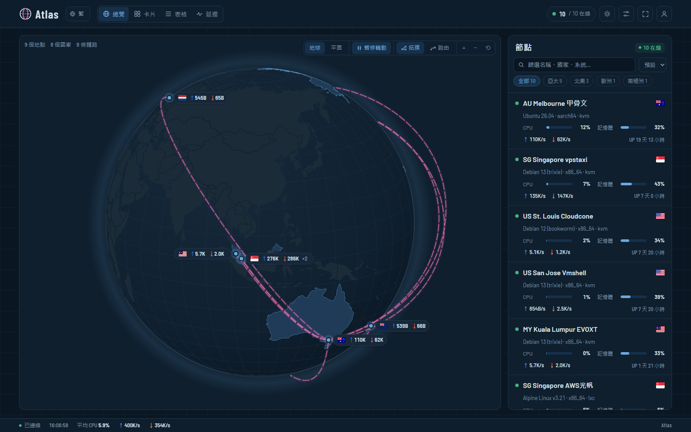

# Atlas

[English](README.md) · **繁體中文** · [简体中文](README.zh-Hans.md)

**展示站：[status.yddsfj.uk](https://status.yddsfj.uk)**（站上的橫幅圖片是站長自己的，不隨主題提供）



[monitor 極簡探針](https://monitor-document.pages.dev/) 的主題：海圖風格的地球／平面地圖，點亮有節點的國家，節點之間以拱形弧線畫出拓撲；另有節點卡片、表格、延遲與詳情頁。支援淺色／深色，介面有繁體中文、简体中文與 English。

主題本身裝上就能用。另外三項是**可選功能**，因為它們要在你的伺服器上跑，需要自己設定：[真實路由](#真實路由)、[海纜底圖](#海纜底圖)、[流媒體檢測](#流媒體檢測)。沒設定的話，主題就不顯示那些部分。

## 安裝

在後台「主題」頁用本倉庫網址安裝（hub 會抓最新 Release 裡的 `theme.tar.gz`），或從 Releases 下載 `theme.tar.gz` 上傳。

### Komari（已暫停）

Komari 版已暫停開發、不再發布，以下程式碼僅留作參考。同一個主題也能裝在 [Komari](https://github.com/komari-monitor/komari)（1.6 以上）：從 Releases 下載 `atlas-komari.zip`，在 Komari 後台的主題設定上傳即可，設定項目會出現在 Komari 的主題設定頁。資料來自 Komari 的公開 API；延遲顯示 Komari 的 Ping 任務，流量欄顯示 Komari 的流量計數。拓撲與位置設定請用節點名稱（或 `#uuid`）。

自己的路由、流媒體快照是以 monitor 的節點 ID 記錄的：執行 `node scripts/komari-ids.mjs` 依名稱對應兩邊的節點、寫出 `src/data/ids.json`，再 `npm run pack:komari` 打包。`npm run dev:komari` 會轉發到 `.env.local` 的 `KOMARI_HUB`。即時 relay（`relay/`）是為 monitor 寫的，在 Komari 上主題會改用打包內建的快照。

## 設定（後台 → 主題 → Atlas → 設定）

- **節點位置**：每行一個節點，`名稱或 #ID = 城市` 或 `= 緯度,經度`。沒寫的節點依名稱裡的城市關鍵字（中英文或機場代碼，見 `src/lib/geo.ts`）定位，再不行就用國家。
  ```
  Tokyo Node A = Osaka
  #8 = -36.85,174.76
  ```
- **節點拓撲**：每行一條鏈路，用 `->` 串接，可寫節點名稱、`#ID`、城市名或 `緯度,經度`；`|` 後面是標籤。
  ```
  Guangzhou -> HK Relay -> SG Node | 中轉
  #1 -> #4 | 落地
  ```
  沒有自訂拓撲時，中心節點（或第一個節點）會連到其他所有節點。
- 地圖模式、自動旋轉、點亮國家、地圖標籤、其他海纜顯示為灰色、總覽、卡片顯示哪些延遲探針、離線排序、公告、預設語言與外觀，以及各項可選功能的開關。

- **橫幅**：總覽頁頂部的大標題框，有小標、大標題（留空用網站名稱）、副標題和即時狀態列；底圖用你自己的圖片（每行「名稱 | https://網址 | 焦點」，焦點是一定要露出的位置如臉，寫成「46% 20%」；圖片鋪滿橫幅、高度隨螢幕寬度等比例變化，右下角按鈕切換，可設定自動輪換），可加右上角頭像。狀態列可顯示伺服器總價值：各節點價格依計費週期換算成一年後加總，不同幣別用你在設定填的匯率（每行「CNY = 0.14」）換成同一種幣別，不連外部服務。主題不附任何圖片，也可整個關掉。
- **背景圖片**（網址、模糊、壓暗）：設定後面板變成毛玻璃，可調玻璃模糊與不透明度。訪客可在設定選單換成自己的圖片（網址，或上傳後只存在自己的瀏覽器）、調整或關掉。

在卡片、表格、延遲頁點節點會開出詳情彈窗（資源趨勢、網路與流量、延遲・丟包、伺服器資訊，可選時間範圍），「完整詳情」開完整頁面；Esc 或返回鍵關閉。

地圖用 Ctrl／⌘ + 滾輪或 +/− 按鈕縮放，一般滾動仍然捲動頁面。訪客可在頂部切換語言與深淺色，設定選單裡的偏好只存在自己的瀏覽器。

## 可選功能

| 功能 | 顯示什麼 | 需要什麼 |
|---|---|---|
| 真實路由 | 拓撲連線改沿封包實際走的路徑，依網路（AS）上色 | 一台能 SSH、裝有 `mtr` 的節點；本機 Node.js；或裝上 relay |
| 海纜底圖 | 跨海段沿海底光纜走，加上海纜底圖 | TeleGeography 2022 快照（限非商業使用） |
| 流媒體檢測 | 各節點 Netflix / Disney+ / ChatGPT 等能否使用 | SSH 快照，或在 hub 旁裝 relay |

快照型的資料會打包進**你自己的版本**：產生資料後執行 `npm run pack`，上傳產生的 `theme.tar.gz`。這些資料放在 `src/data/`、`scripts/data/`，已被 git 忽略，不會進公開版。

### 真實路由

地圖上的「路由」按鈕把每條拓撲連線改畫成實際路徑，依 AS 上色，附圖例，節點側欄還有逐個 AS 的時間軸。

```bash
cp routes.local.example.json routes.local.json   # 填入你的節點
node scripts/routes.mjs          # 追蹤 routes.local.json 列出的所有鏈路
node scripts/routes.mjs 1>3      # 只追蹤一條
node scripts/routes.mjs --replan # 不重新追蹤，只重算跨海段
npm run pack
```

腳本透過 SSH 在來源節點執行 `mtr --json`，依路由器反向 DNS 裡的城市代碼定位，查不到再用 ip-api.com，並剔除 RTT 上不可能或繞路的位置。輸出只有 AS、城市、座標與延遲，腳本和打包都會拒絕任何節點 IP 進入安裝包。

**即時模式**：裝了 [`relay/`](relay/README.md) 之後，改由 relay 追蹤：從來源節點到每台節點，每天一次，管理員也能按「追蹤路由」／「重新追蹤」；新節點裝好 agent 就會自動追蹤，不用重新打包。

注意：traceroute 只看得到單向路徑，路由會變，走哪條海纜是推測。

### 海纜底圖

跨海段會沿海底光纜畫，底下另畫完整的海纜底圖（滑鼠移上去看名稱、啟用年份、長度與業主）。資料來自 TeleGeography 在 GitHub 公開的 Submarine Cable Map，授權 **CC BY-NC-SA 3.0**（2022-08-05 快照）。原倉庫已移除，Internet Archive 留有存檔。**本倉庫不附這份資料**：授權限非商業使用，請只在非商業的狀態頁自行匯入。

```bash
node scripts/import-cables.mjs <…/web/public/api/v3 的路徑>
node scripts/routes.mjs --replan
npm run pack
```

設定裡的「其他海纜顯示為灰色」會把沒有節點路由經過的海纜畫成灰色，路由比較容易辨認。

### 流媒體檢測

節點詳情、側欄和卡片會顯示 Netflix（完整／僅自製劇）、Disney+、YouTube Premium、Prime Video、ChatGPT、Claude、Gemini、Bilibili 港澳台、Abema、Spotify、TikTok 能否使用，以及服務判定的國家（與節點所在地不同時標黃）。兩種方式：

- **快照**，打包進你的版本：
  ```bash
  node scripts/media.mjs           # routes.local.json 裡有 SSH 的節點
  node scripts/media.mjs --local   # 在本機執行，只印出結果
  npm run pack
  ```
- **即時**：在 hub 旁裝 [`relay/`](relay/README.md)，節點每天自動重測，登入的管理員可按「點擊檢測」／「重新檢測」，約一分鐘出結果。公開版也能用，主題會自動找 `/atlas-media/`。

兩者都沒有時，這個區塊不顯示。

## 開發

```bash
npm ci
echo MONITOR_HUB=https://status.example.com > .env.local   # 一個開啟公開頁面的 hub
npm run dev          # /api、WebSocket 和 /atlas-media 轉發到 MONITOR_HUB
npm run pack         # 你的版本：含本機資料
npm run pack:base    # 公開版：一律不含 src/data
```

## 發布

修改 `theme.json` 的 `version`，commit 後推一個 `v<版本號>` tag，`.github/workflows/release.yml` 會從乾淨的倉庫打包基礎版，發布為 Release 附件 `theme.tar.gz`。

## 授權

程式碼採 MIT（見 `LICENSE`）。可選的海纜資料維持其 CC BY-NC-SA 3.0 授權，不在本倉庫內。
